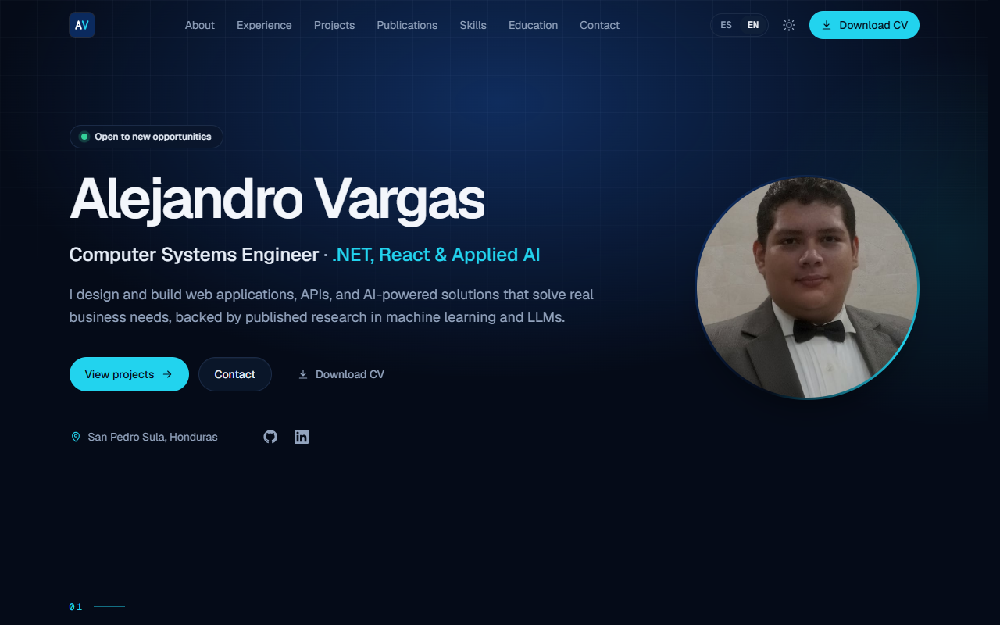

# Alejandro Vargas — CV and portfolio

Bilingual (ES/EN) CV and portfolio of Alejandro Vargas, Computer Systems Engineer.

**Live site:** https://aledev-hsd0hhbzf6cvhrax.eastus2-01.azurewebsites.net/



## Stack

- Next.js 16 (App Router) as a **static export**, React 19, TypeScript 6 (strict) and Tailwind CSS 4.
- A single library on top of that, [Motion](https://motion.dev), for the animations that need physics, layout or gestures. The rest of the motion is CSS and native View Transitions.
- Own SVG icons and own i18n, with no extra packages.
- GitHub Actions for CI/CD and Azure App Service (Windows, IIS) for hosting.

## Run it locally

Requirements: Node.js 20.9 or newer (24 recommended).

```bash
npm ci
npm run dev
```

The development server runs at http://localhost:3000 and redirects to `/es/`.

| Command | What it does |
| --- | --- |
| `npm run dev` | Development server at http://localhost:3000. |
| `npm run build` | Generates the static site in `out/`. |
| `npm run preview` | Serves `out/` the way IIS would, at http://localhost:4173. |
| `npm run lint` | ESLint. |
| `npm run typecheck` | TypeScript type check. |
| `npm run cv:pdf` | Builds the site and regenerates `public/cv/*.pdf` from the CV data. Needs Node 22.18 or newer and Microsoft Edge or Google Chrome. |

In `npm run dev` the Next.js button and its "Issues" notices are hidden (`devIndicators: false` in `next.config.ts` and `<HideDevOverlay />` in `src/app/[lang]/layout.tsx`). Errors still show in the terminal; remove `<HideDevOverlay />` to see them in the browser too.

## Technical decisions

### Static export instead of a Node server

The App Service that hosts the site is **Windows** (IIS).

- On Windows, Node runs behind iisnode, which passes the port as a named pipe. The `server.js` of `output: "standalone"` expects a numeric port, so it would need a custom server.
- The site needs no server, so it is exported to static HTML and IIS serves it directly: no cold starts and no Node version to maintain on Azure.
- `public/web.config` does the work the server would do:
  - redirects `/` to `/es/` and serves the 404 page;
  - declares the MIME types (`.woff2`, `.webp`, `.avif`);
  - applies a one-year cache to `/_next/static` and revalidation to the HTML;
  - adds security headers and removes `X-Powered-By`.

### All the content in one typed file

The whole CV lives in `src/data/cv.ts`, and the components never hold content.

- Every translatable text is an `{ es: "…", en: "…" }` object, so both languages are edited side by side.
- The downloadable PDFs come from the same data: `npm run cv:pdf` builds the site and prints `/es/cv/` and `/en/cv/` with headless Edge or Chrome.
- The project gallery imports the project data directly, so the texts are not duplicated in the HTML.

### Almost no dependencies

- The icons are the site's own SVGs and the i18n is its own module, with no packages behind them.
- Motion is loaded with `LazyMotion`: the `m` components travel in the initial bundle and the engine (`domMax`) arrives in a deferred chunk when the browser is idle.
- What only follows the cursor or the scroll (progress bar, trajectory line, hero spotlight, magnetic buttons) is also loaded lazily (`components/motion/deferred.tsx`).

### Motion from a single set of tokens

All the motion comes from `src/lib/motion.ts`: curves, durations (150 ms micro, 300 ms interface, 600 ms entrances), distances, staggers and springs. Motion imports them as they are and CSS receives them as `--m-*` variables (generated by `lib/motion-css.ts` and injected by the layout), so changing a value there changes it across the site. On mobile those variables step down, and with reduced motion the distances are zero.

- **Only `transform` and `opacity` are animated**, the content is visible without JavaScript and `prefers-reduced-motion` is respected.
- **Primitives** (`src/components/motion/`): `<Reveal>` (appears when it enters the screen), `<Stagger>` (its children enter one after another), `<TextReveal>` (by words or by lines, with a mask) and `<Magnetic>` (follows the cursor slightly). They only mark the HTML, so they work the same in server components.
- **Scroll reveals:** the HTML arrives with everything visible. `RevealRuntime` hides only what is still below the fold and reveals it once, with a single `IntersectionObserver`. Without JavaScript, or if hydration fails, nothing stays hidden.
- **Hero:** its entrance is pure CSS, so it does not depend on hydration or delay the content.
- **Project detail:** a shared element transition with View Transitions, and a fade where they are not supported.

To try reduced motion in Chrome or Edge: DevTools → ⋮ → *More tools* → *Rendering* → *Emulate CSS media feature prefers-reduced-motion* → `reduce`. There should be no movement, only short fades.

### A project gallery that keeps its text in the HTML

The projects live in a compact gallery (`components/projects/project-gallery.tsx`).

- Status filters with a sliding pill, and cards that reflow.
- The full detail opens in a `<dialog>` that the card "grows" into, carrying its image and title.
- Previous and next with buttons, with ← →, or by swiping on touch; Esc or a click outside closes it.
- On mobile the cards are a swipeable carousel.
- All the text of every project stays in the static HTML.

### Theme and SEO

- Dark theme by default with a switch to light. The preference is saved and `prefers-color-scheme` is respected.
- Per-language metadata with `hreflang`, an Open Graph image built with `next/og`, JSON-LD `Person`, `sitemap.xml` and `robots.txt`.

## Project structure

```
.github/workflows/deploy.yml   CI/CD: lint, build and deploy to the App Service
public/
  cv/                          CV as PDF in ES and EN (npm run cv:pdf)
  projects/                    Project images (SVG placeholders for now)
  web.config                   IIS rules: redirect, 404, cache, MIME types and headers
scripts/                       PDF generator and local server for the export
src/
  app/
    (root)/                    "/" → redirects to /es/
    [lang]/                    Page per language: layout, page, cv/ (printable version), og.png/
    global-not-found.tsx       Bilingual 404
    sitemap.ts, robots.ts      SEO
    icon.svg, favicon.ico, apple-icon.png
    globals.css                Color tokens, typography and animations
  assets/fonts/                Geist as TTF for the Open Graph image
  components/                  layout/ (navbar, theme, language), sections/ (one per section), ui/,
                               motion/ (motion primitives and pieces), projects/ (gallery)
  data/
    cv.ts                      ← All the CV content (ES and EN)
    ui.ts                      Interface texts
    types.ts                   Content types
  lib/                         i18n, theme, JSON-LD, OG image, utilities and motion tokens (motion.ts)
```

## Editing the content

Everything is in **`src/data/cv.ts`**; the components do not need to be touched.

- The order of the arrays is the order on screen (experience, projects…). Publications sort themselves by year, newest first; within the same year the order of the file is kept.
- **"Open to new opportunities" badge:** `profile.availableForWork: true | false`.
- **Photo:** a square JPG of at least 400 × 400 px in `public/images/profile.jpg`. Without a photo, the monogram is shown.
- **Project screenshots:** export each one as WebP at about 1600 × 1000 px (16:10), already optimized, because the site has no image optimizer. Save it in `public/projects/` under a new name if it replaces another (because of the cache), then update `image` and describe it in `imageAlt`.
- **Project status:** `production`, `active`, `delivered`, `pilot` or `development`. Without `status` no badge is shown. With `ongoing: true` the year reads "2025 — Present".
- **Publications:** `status` is `published` or `pending`. The DOI button appears only with a `doi` (or `url`), and the abstract only with an `abstract`.
- **Interface texts** (menu, buttons, section titles): `src/data/ui.ts`.
- **Site URL** (for a custom domain later): `src/lib/site.ts`, or the `NEXT_PUBLIC_SITE_URL` variable at build time.

After changing the content, run `npm run cv:pdf` and commit `public/cv/` so the PDFs match the site.

## Deployment

Every push to `main` runs [`.github/workflows/deploy.yml`](.github/workflows/deploy.yml):

1. `npm ci`, `npm run lint` and `npm run build`.
2. Packages `out/` as a zip.
3. Publishes it to the `aledev` App Service with `azure/webapps-deploy`, authenticated with the publish profile stored in the `AZURE_WEBAPP_PUBLISH_PROFILE` secret.
4. `clean: true` empties `wwwroot` before publishing, so no files of the previous site remain.

Pull requests only run lint and build.

### First-time setup

1. **Download the publish profile.** In the [Azure portal](https://portal.azure.com), open *App Services* → `aledev` → *Overview* → **Download publish profile**. If the button is disabled, go to *Settings* → *Configuration* → *General settings*, turn on **SCM Basic Auth Publishing Credentials**, save and try again.
2. **Create the secret on GitHub.** In the repository, go to *Settings* → *Secrets and variables* → *Actions* → **New repository secret**. Name it `AZURE_WEBAPP_PUBLISH_PROFILE` and paste the full content of the `.PublishSettings` file. From the command line:
   ```bash
   gh secret set AZURE_WEBAPP_PUBLISH_PROFILE < path/to/aledev.PublishSettings
   ```
   Delete the downloaded file afterwards: it contains credentials. The `.gitignore` already excludes it.
3. **Recommended App Service settings** (*Configuration*): HTTPS only on; ARR affinity off (it removes a cookie a static site does not need); no startup command (IIS serves the static files, and the App Service's Node version is no longer used).
4. **Publish.** Push to `main`, or run *Actions* → *Build and deploy* → **Run workflow**.

## Licenses

The Geist font (Vercel) is distributed under the SIL Open Font License 1.1; see [`src/assets/fonts/OFL.txt`](src/assets/fonts/OFL.txt).
